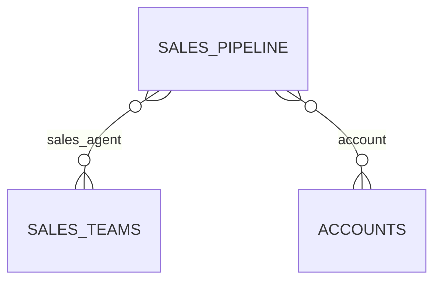

# CRM Pipeline Analysis

Portfolio SQL from Samuel León, Revenue Operations Manager. The query in this repository enriches each CRM pipeline deal with the sales manager, regional office, and account sector so the pipeline can be sliced by team, region, and industry.

## Business question

Which sales manager, regional office, and account sector belong to each deal in the pipeline?

`sql/enriched_sales_pipeline.sql` answers that by starting from every row in `crm.sales_pipeline` and attaching:

- `manager` and `regional_office` from the sales team, for team and region slices
- `sector` from the account, for industry slices

## Data model

The query uses three tables in the `crm` schema.

| Table | Alias | Role |
| --- | --- | --- |
| `crm.sales_pipeline` | `p` | Deal grain. Every column is returned with `p.*`. |
| `crm.sales_teams` | `t` | Team lookup. Adds `manager` and `regional_office`. |
| `crm.accounts` | `a` | Account lookup. Adds `sector`. |

Join keys:

- `t.sales_agent = p.sales_agent`
- `a.account = p.account`

Both lookups are `LEFT JOIN`s. A pipeline deal stays in the result when `crm.sales_teams` has no row for that sales agent, and it stays in the result when `crm.accounts` has no row for that account. On those deals the unmatched attributes are null.

Columns this query names, aside from the full `crm.sales_pipeline` row carried by `p.*`, are `sales_agent`, `account`, `manager`, `regional_office`, and `sector`.



The diagram shows the two lookups in the `crm` schema. Each line is labeled with its join key. Columns returned only through `p.*` are left off the diagram.

## How it's used

The statement in `sql/enriched_sales_pipeline.sql` is the custom query of a Looker Studio data source that uses the PostgreSQL connector. Looker Studio sends the statement to PostgreSQL and uses the result set as that data source. Connection settings stay in the Looker Studio data source.

## Tech

- **PostgreSQL** runs the query.
- **Looker Studio** (formerly Data Studio) holds the dashboard. The data source uses the PostgreSQL connector's custom-query option.

## Repository structure

```text
.
├── README.md
└── sql/
    └── enriched_sales_pipeline.sql
```

Dashboard images will live under `assets/` and be linked from the section below.

## Dashboard screenshots

<!-- PLACEHOLDER: add Looker Studio dashboard screenshots under assets/ and embed them here. -->

**Placeholder.** Screenshots of the Looker Studio dashboard will be added later as files under `assets/`.
