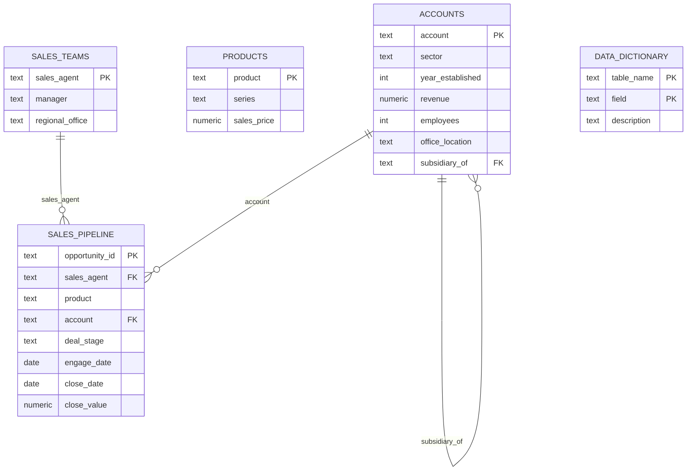

# CRM Pipeline Analysis

An analysis of 8,800 sales opportunities from a software CRM, covering March through December 2017. The team closed $10,005,534 in won revenue at a 63.15% win rate. Agent revenue gaps come from volume and deal size, not from close rate.

## Business question

Which agents, products, and regional offices drive won revenue, how consistent is the win rate, and where should sales leadership focus next?

## Key findings

All figures were computed in SQL against the Supabase `crm` schema and match the Looker Studio dashboard.

1. **Headline performance.** Of 8,800 opportunities, 4,238 were Won, 2,473 were Lost, 1,589 are Engaging, and 500 are Prospecting. That is 6,711 closed deals and a 63.15% win rate, for $10,005,534 in won revenue. The 2,089 open deals have no close date or close value.

2. **Revenue gaps are volume and deal size, not close skill.** Across the 30 agents with deals, win rates only span 55.0% (Lajuana Vencill) to 70.4% (Hayden Neloms). Won revenue spans $123,431 (Violet Mclelland) to $1,153,214 (Darcel Schlecht). Darcel closed 349 of 553 deals and $1,153,214, more than double the next agent (Vicki Laflamme, $478,396). The average won deal is $2,360.91, but the median is $1,117, so a smaller number of large deals pulls the average up.

3. **GTX Pro is the revenue engine.** After normalizing the `GTXPro` / `GTX Pro` product name typo, GTX Pro contributed $3,510,578 (35.1% of won revenue) from 729 won deals, at an average of $4,816. GTX Pro and GTX Plus Pro together are 61.4% of won revenue. MG Special closed 793 deals, the second-highest win count, but only $43,768 because the average won deal is $55.

4. **West leads in revenue, Central leads in volume.** The West office produced $3,568,647 from 1,438 won deals (average $2,482). Central closed more deals (1,629) but only $3,346,293, because its average won deal is $2,054. Melvin Marxen's team is the top manager group at $2,251,930. Dustin Brinkmann's team closed 747 won deals, second by count, but only $1,094,363, with an average won deal of $1,465.

5. **Won revenue bunches at quarter end.** Closings in this dataset run from 1 March 2017 to 31 December 2017. Revenue peaks in March ($1,134,672), June ($1,338,466, the high), September ($1,235,264), and December ($1,131,573), then drops the month after: April $721,932, July $696,932, and October $731,980. Won deals take 51.8 days on average from engage date to close date (median 57 days).

## Dashboard

Live report (Looker Studio, public link): [CRM Pipeline Analysis](https://datastudio.google.com/reporting/77638945-03cb-4aa7-8e0f-95f4b0f22e1d)


The dashboard has four KPI cards (won revenue, won deals, closed deals, win rate), an agent leaderboard sorted by won revenue, a pipeline-by-stage bar chart, and a monthly trend of won revenue and won deals. A date range control on `close_date` filters every chart.

## Data and schema

Source: [innocentmfa/crm-sales-opportunities](https://www.kaggle.com/datasets/innocentmfa/crm-sales-opportunities) on Kaggle (8,800 pipeline rows, 85 accounts, 7 products, 35 sales agents).

The warehouse is a Supabase Postgres database (project `crm-analytics-lab`). Tables live in the `crm` schema, not `public`.



Primary keys: `accounts.account`, `products.product`, `sales_teams.sales_agent`, `sales_pipeline.opportunity_id`, and `data_dictionary (table_name, field)`. The original data dictionary column `Table` was renamed to `table_name` on load.

Foreign keys: `sales_pipeline.sales_agent` to `sales_teams`, `sales_pipeline.account` to `accounts`, and `accounts.subsidiary_of` to `accounts`. There is no foreign key from `sales_pipeline.product` to `products`, because 1,480 pipeline rows use `GTXPro` while the products table uses `GTX Pro`.

## Data quality issues and how SQL handles them

These issues were left in the data on purpose, then documented and handled in queries rather than silently rewritten.

- **Product name typo.** 1,480 pipeline rows say `GTXPro`; the products table has `GTX Pro`. Joins use `REPLACE(product, ' ', '')` so both sides match as `GTXPro`. That is also why the product foreign key was not created.
- **Sector typo.** `technolgy` appears on 12 accounts (should be technology). Flagged in `sql/02_data_quality_checks.sql`, not corrected in place.
- **Country typo.** `Philipines` appears on 1 account (Bioholding). Flagged in the same quality checks.
- **Nulls in the pipeline.** `account` is null on 1,425 rows (1,088 Engaging, 337 Prospecting). `engage_date` is null on all 500 Prospecting rows. `close_date` and `close_value` are null on 2,089 rows, all of them Engaging or Prospecting. Win rate and won revenue ignore open deals: they are excluded from the closed-deal denominator, and `SUM(close_value)` skips nulls. Lost deals are stored as `close_value = 0`, so the unfiltered sum of `close_value` already equals won revenue.
- **Five agents have no deals.** Carl Lin, Carol Thompson, Elizabeth Anderson, Mei-Mei Johns, and Natalya Ivanova. A `LEFT JOIN` from `sales_teams` in `sql/04_agent_performance.sql` keeps them visible. The Looker table shows 30 agents because it starts from pipeline rows.

## Method

1. Download the Kaggle dataset `innocentmfa/crm-sales-opportunities`.
2. Load it into Supabase Postgres (`crm` schema) so the warehouse, not the CSV, is the source of truth for analysis.
3. Run the SQL in `sql/` for quality checks, headline KPIs, agent performance, and trends.
4. Connect Looker Studio to Supabase through the session pooler, using the custom query in `sql/06_looker_data_source.sql`. Calculated fields: `Won Deals`, `Closed Deals`, and `Win Rate` (`Won Deals / Closed Deals`). Win rate is computed from the two sums, not as an average of 0/1 flags, so open deals do not pull the rate down.

## Recommendations

1. **Coach agents on deal mix, not just activity.** Close rates are already tight. The spread in revenue comes from how many deals an agent works and which products they sell. Agents such as Versie Hillebrand (176 won deals, $187,693, average $1,066) and Anna Snelling (208 won deals, $275,056, average $1,322) are busy on smaller products. Point them toward GTX Pro and GTX Plus Pro, which already generate 61.4% of won revenue.

2. **Plan for the quarter-end spike, and try to smooth it.** June closed $1,338,466 and July dropped to $696,932. A flat monthly forecast would miss both the quarter-end peak and the hangover. Review what is pushed into the last month of the quarter, and start qualifying next-quarter pipeline earlier so April, July, and October are not systematically weak.

3. **Clean the CRM so reporting stays trustworthy.** Normalize `GTXPro` to `GTX Pro` and then add the product foreign key. Fix the `technolgy` and `Philipines` spellings. Require an account once a deal leaves Prospecting (1,088 Engaging rows have no account). Review the five agents with zero deals: either they are not active and should leave the roster, or they are hired capacity that is not being used.

## Repo structure

```text
crm-pipeline-analysis/
├── README.md
├── .gitignore
├── images/
│   └── dashboard.png
├── data/
│   ├── README.md
│   ├── accounts.csv
│   ├── products.csv
│   ├── sales_teams.csv
│   ├── data_dictionary.csv
│   └── sales_pipeline_sample.csv
└── sql/
    ├── 01_schema.sql
    ├── 02_data_quality_checks.sql
    ├── 03_kpis.sql
    ├── 04_agent_performance.sql
    ├── 05_pipeline_trends.sql
    ├── 06_looker_data_source.sql
    └── enriched_sales_pipeline.sql
```

`sql/enriched_sales_pipeline.sql` is the enriched join used as the Looker Studio dashboard source. It is the same query as `sql/06_looker_data_source.sql`; both files are kept.

## How to reproduce

1. Create a Postgres database (Supabase works well as a lightweight warehouse) and run `sql/01_schema.sql`.
2. Download the full dataset from [Kaggle](https://www.kaggle.com/datasets/innocentmfa/crm-sales-opportunities). The complete `sales_pipeline.csv` (8,800 rows) is not in this repo; only a 200-row sample is.
3. Load CSVs into the `crm` tables in this order: `sales_teams`, `products`, `accounts`, `data_dictionary`, `sales_pipeline`. Rename the data dictionary column `Table` to `table_name` on load. For `accounts`, load parent accounts before subsidiaries, or add the `subsidiary_of` foreign key after the load.
4. Run `sql/02_data_quality_checks.sql` and confirm the issue counts above. Then run `sql/03_kpis.sql`, `sql/04_agent_performance.sql`, and `sql/05_pipeline_trends.sql`. Each file is commented with the question it answers and the expected result.
5. In Looker Studio, add a PostgreSQL data source pointed at the Supabase **session** pooler (the transaction pooler will not work, and the direct host is IPv6 only). Enable SSL and upload the project's SSL certificate. The Tables picker only lists `public`, so use a custom query and paste `sql/06_looker_data_source.sql`. Add the three calculated fields listed in that file, then build the KPI cards, agent table, stage chart, and monthly trend.

Author: Samuel León. GitHub: [Samwyx/crm-pipeline-analysis](https://github.com/Samwyx/crm-pipeline-analysis).
